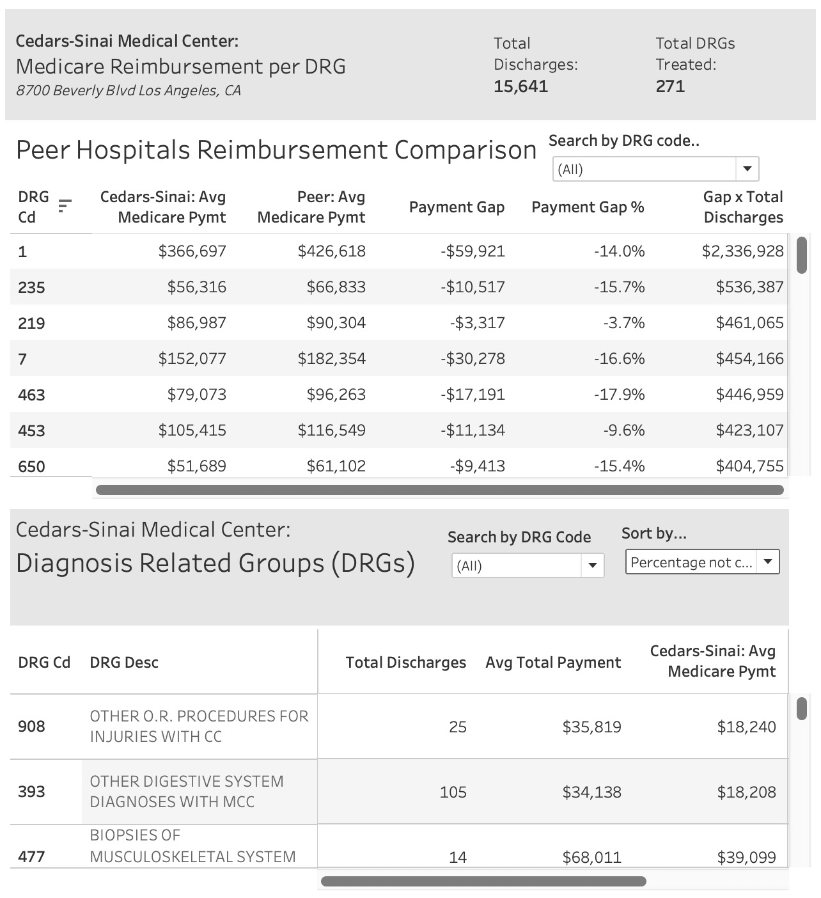
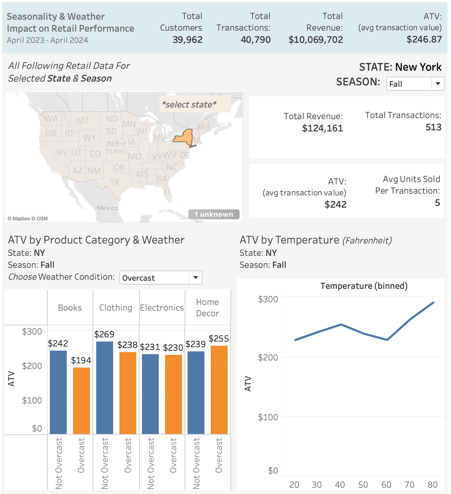

# Portfolio

## Technical Skills 

- Python
- SQL
- Tableau
- Excel

## Projects

- [Medicare Reimbursement Chart](https://github.com/isela-24/medicare-reimbursements)

  Identified DRGs (Diagnostic Related Groups) at Cedars-Sinai Medical Center that received lower reimbursements from Medicare compared to peer hospitals, using public data from the Centers for Medicare and Medicaid Services

    

 

- [Retail Performance Dashboard](https://github.com/isela-24/retail-weather-dashboard)

  Built an interactive dashboard that examines how seasonality and weather affect consumer purchasing behavior across each state

    

 

- [View all my projects](https://github.com/isela-24?tab=repositories)

  

  
